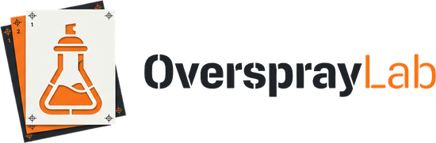
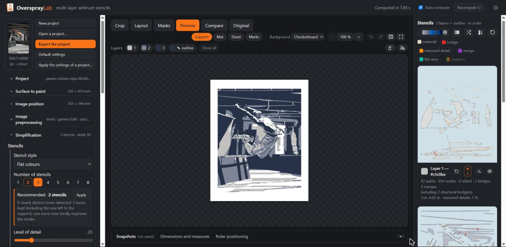
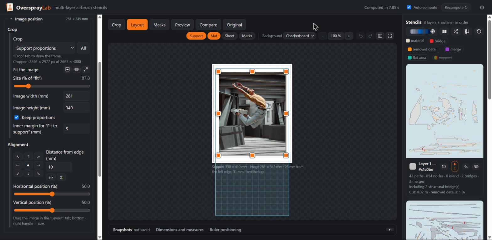
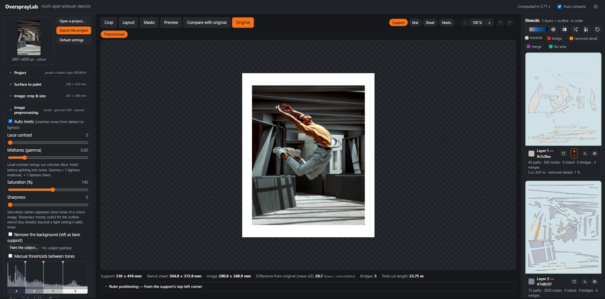
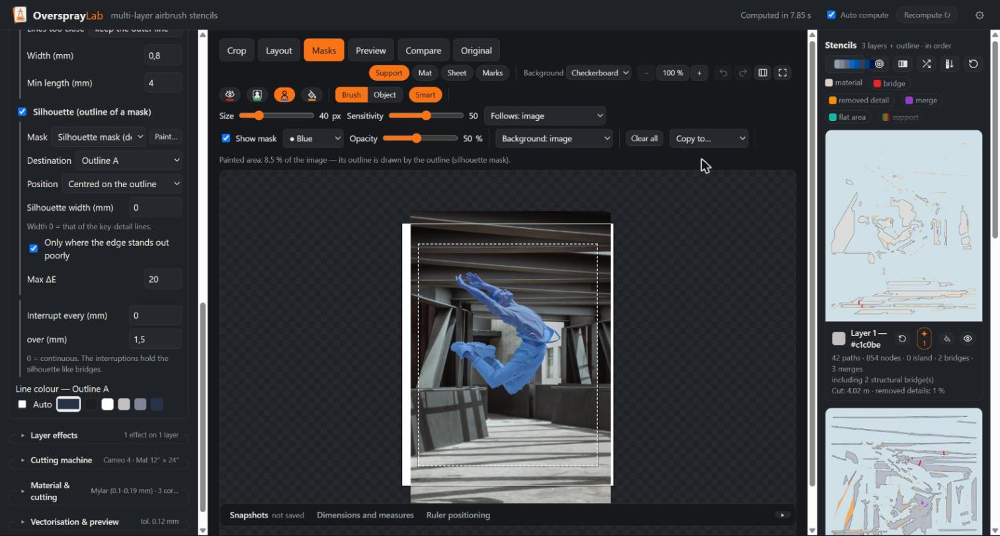
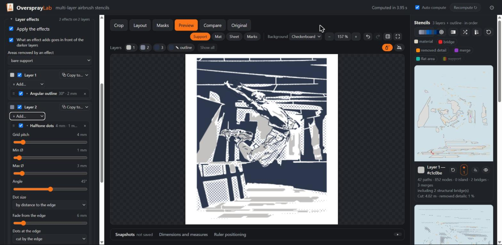
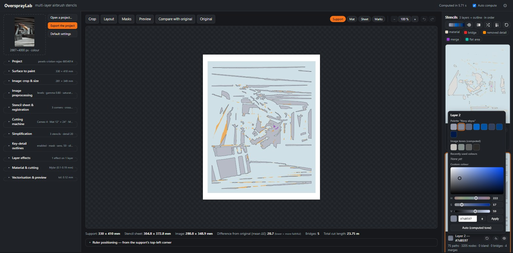
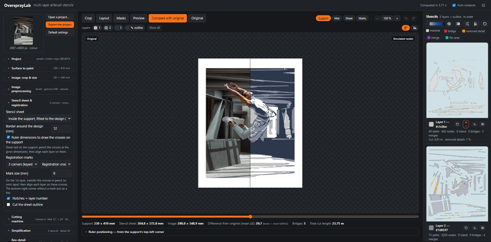
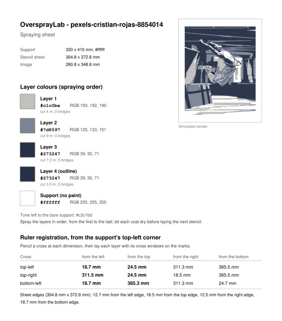

# OversprayLab

<p align="center">
  <picture>
    <source media="(prefers-color-scheme: dark)" srcset="docs/logo-dark.png">
    
  </picture>
</p>

**Turn any picture into a set of multi-layer airbrush stencils, ready to cut on a Silhouette Cameo.**

OversprayLab is a small web application that runs on your own computer. Give it a photo or a
drawing: it reduces the image to a few paint tones, builds one cuttable stencil per tone, adds the
bridges that hold the stencils together and the marks that line them up, and exports everything as
**SVG files in millimetres**, with a printable spraying sheet.



*Example project used in the screenshots: a dancer's leap turned into 3 stencils (light grey,
slate, navy) on white paper 330 × 410 mm, plus an outline stencil for the key details.*

---

## What it does

With an airbrush you build an image from the lightest tone to the darkest, spraying through one
stencil after another. OversprayLab takes care of the tedious part:

| Problem | What OversprayLab does |
|---|---|
| A photo has millions of colours | Reduces it to **1 – 8 paint tones**, sorted in spraying order, and recommends a number. |
| The inside of an "O" falls out of the stencil | Detects these **islands** and holds them with **bridges**, preferably where a darker layer paints over them; or merges them away when the visible change is small. |
| Shapes too thin to cut, parts that flap | Enforces the **material limits** and adds **structural bridges** to badly held parts. |
| Layers must line up | **Registration marks** (corner brackets, crosses, pin holes), layer-number notches, ruler measurements. |
| Fine details vanish in the airbrush blur | **Key-detail lines** and the subject's **silhouette**, on an outline stencil or cut into a colour layer. |

## Installation

Requirements: **Windows, Linux or macOS** with **Python 3.10+** (any recent browser).

Start the launcher of your system: the first launch creates a virtual environment and installs the
dependencies, then the application opens in the browser at **http://127.0.0.1:5000**.

- **Windows**: double-click **`start.bat`**.
- **Linux**: run **`./start.sh`** in a terminal. On Debian/Ubuntu, the venv module may need to be
  installed first: `sudo apt install python3-venv`.
- **macOS**: double-click **`start.command`** (or run `./start.sh` in a terminal). The first time,
  macOS may block it: right-click it, then **Open**. Python 3.10+ comes from
  [python.org](https://www.python.org/downloads/) or Homebrew (the `python3` of the Xcode tools is
  too old).

If port 5000 is already used by another program (on macOS, the AirPlay Receiver), the next free
port from 5002 to 5009 is used instead; the console shows the address. Manually (any OS):

```
python -m venv .venv
.venv\Scripts\python -m pip install -r requirements.txt      # Linux/macOS: .venv/bin/python
.venv\Scripts\python app.py --open
```

Everything runs locally; your images never leave your computer. The **Object** selection tool
downloads its model once on first use (MobileSAM, ~45 MB, checked by SHA-256). The interface is in
English or French (**⚙ Preferences**).

## Quick start

1. **Drop an image** on the image box (`samples/test_visage.png` is a good first test).
2. **Surface to paint**: size (A4, 24 × 30 cm, 6F…) and colour of your support.
3. **Simplification**: number of stencils (3 is a good start).
4. **Cutting machine** and **Material & cutting**: your Cameo, mat and material (e.g. Mylar).
5. Check the **Preview** and the stencil cards on the right, then **Export the project**.

Open the SVG files in Silhouette Studio, cut, and spray layer 1, 2, 3… in order.

---

## Main features

### Layout on the support

Crop the image, then place and size it on the support (fit, fill, or **fit to stencil**: as large
as the cutting mat allows). The **Support**, **Mat**, **Sheet** and **Marks** buttons show the
support, the cutting mat, the material sheet and the registration marks in every view, so you see
at once whether the stencil fits. A warning tells you when the image resolution is too low (or
uselessly high) for its printed size.



### Image preprocessing

Levels, local contrast (CLAHE), shadows / highlights, gamma, an editable **tone curve** with
presets, saturation, sharpening, background removal. The histogram shows where each tone ends; drag
its lines for **manual thresholds**. Preprocessing only guides the cut: paint colours are always
measured on the original photo. For a deeper preparation of the source image, see the
[Qwen-Image-Edit prompts](docs/qwen_prompts.md).



### Simplification

- **Stencil style**: flat colours (one layer per tone) or **lines only** (a line drawing / colouring book).
- **Level of detail**, **hue weight** (split colours of similar lightness), **colour vividness**.
- **Flat areas**: poster-like flat layers, automatic or painted zone by zone, optionally forced into a given layer.
- **Stacking**: exclusive (each layer paints its own tone) or cumulative (layers overlap, forgiving registration).
  In exclusive stacking no spot is painted by two layers; two options relax it: a lighter layer may paint
  under a darker one (merges and material limits, hidden, fewer bridges), and key details cut into a colour
  layer may be painted over the lighter layers instead of being removed from them (general setting, each
  zone can override it).
- **Merge instead of bridges**: close narrow channels or drop small islands when the visible change stays small.

### Masks and object selection

Paint masks with a brush, a **smart brush** that follows colour edges, or select objects with one
click (**Object** tool, Segment Anything / MobileSAM). Four masks: **subject** (background removal),
**key details** (where to look for lines, one per zone), **silhouette** and **flat areas**.



### Key details and silhouette

Fine lines lost by the simplification are found again and sent to an **outline stencil** sprayed
last, or cut into a colour layer. Five detection methods: sharp edges (Canny), drawn line (DoG),
flowing drawn line (FDoG), thin lines (ridges) and **learned edges** (TEED, a small neural network
shipped with the app). The search can be split into zones with their own settings. The
**silhouette** option draws the outline of a mask, only where the subject does not stand out,
with optional interruptions to hold it like bridges.

### Bridges and material

Material presets set the minimum opening, strip and piece area. Bridges are short, kept away from
other edges and placed where possible under darker paint. **Structural bridges** hold long thin
strips and large pieces; a **support map** on the cards shows how well each part is held. You can
also **draw bridges by hand** or remove automatic ones.

### Layer effects

Each layer gets its own stack of effects, applied before the bridges: smoothing, polygonal or
angular outlines, rough or wavy edges, drips, **halftone dots**, **halftone lines**, hatching, engraving, contour lines,
patterns, outline only, drop shadow, halo, blends between layers, mosaic, decorative bridges,
overlap…



### Paint colours and palettes

Click a layer's swatch to pick a colour (palette, image tones, HSV picker, eyedropper). Or apply one
of **99 built-in palettes** (or your own): *Closest* assigns the colours by perceptual distance, *By
values* by lightness as on a screen-printed poster, *Other colours* shuffles the combinations. The
**palette assistant** proposes complete colour schemes (styles, harmonies, vividness…) previewed
on the real stencils.



### Check the result

**Preview** stacks the real stencils (bridges included) on the support colour, optionally with a
**simulated airbrush render**. **Compare** puts the original, the preprocessed image, the current
version or any snapshot on either side of a slider (or side by side), with the mean colour
difference (ΔE).



### Export

**Export the project** produces a zip with:

- one **SVG cutting file per layer** (mm, registration marks, number notches), plus the outline stencil;
- `silhouette.svg` for Silhouette Studio (one compound path per layer) and an `inkscape.svg` document;
- an overview SVG, the simulated render (PNG) and the **spraying sheet** (PDF): colours in spraying
  order, ruler measurements for the registration crosses;
- the original image, the masks and `infos.json` with every setting, so the project can be reopened.



### Projects, snapshots and presets

- **Snapshots** keep versions of a project (image, masks, settings and computed result) in the
  `projets/` folder; click a thumbnail to go back to it instantly.
- **Open a project…** reopens recent projects, a project folder or an exported zip.
- **Undo / redo** (Ctrl + Z / Ctrl + Y) covers settings and painted masks.
- Your own supports, materials, mats, machines and palettes are saved as presets.

---

## Cutting and painting

1. In Silhouette Studio (Designer Edition or higher for SVG import), open `silhouette.svg` or one
   layer file. Sizes are in mm: do not rescale. Do a test cut, then cut each layer.
2. Fix the support; for stencils inside the support, pencil the registration crosses using the ruler
   measurements of the spraying sheet.
3. Spray layer 1 (lightest), then 2, 3… aligning the marks each time; finish with the outline
   stencil. Light, short passes with the stencil held flat give the sharpest edges.

## Tips

| Symptom | What to try |
|---|---|
| Details disappear | Make the image larger, choose a finer material, add key-detail lines. |
| Too many bridges | Raise *Merge instead of bridges*, lower the level of detail, or use cumulative stacking. |
| Two colours end up in one tone | Raise the hue weight or the saturation, add a stencil, or set manual thresholds. |
| The subject does not stand out | Select it with the Object tool and tick *Silhouette*. |
| Dull colours | Raise *Colour vividness*, or pick a palette with *Closest*. |
| Computing is slow | Untick *Auto compute* and recompute with **Ctrl + Enter**. |

Hover any setting for a tooltip explaining it.

## How it works

The image is cropped and resampled at its real size, preprocessed, then clustered into tones
(k-means in Lab). Each tone becomes a layer mask, cleaned up to the material limits, reshaped by the
layer effects, then held by merges and bridges before being vectorised into Bézier curves.

```
overspraylab/
├── pipeline.py      image → layers → bridges → paths
├── effects.py       layer effects
├── svg_export.py    SVG / Inkscape / zip export
├── pdf_sheet.py     spraying sheet (minimal PDF writer)
├── semantic.py      object selection (MobileSAM, ONNX)
├── teed.py          learned edges (TEED, ONNX)
└── projects.py      projects folder and snapshots
app.py               web server (Flask)
static/index.html    the interface (+ i18n.js: English / French)
```

## License

OversprayLab is released under the [MIT License](LICENSE).

The learned edges method uses TEED (*Tiny and Efficient Edge Detector*, X. Soria, Y. Li, M. Rouhani,
A. D. Sappa, 2023, [github.com/xavysp/TEED](https://github.com/xavysp/TEED)), MIT License,
Copyright (c) 2022 Xavier Soria Poma: see `overspraylab/edge_model/LICENSE_TEED.txt`. The ONNX file
was exported from its BIPED checkpoint by `tools/export_teed_onnx.py`.
